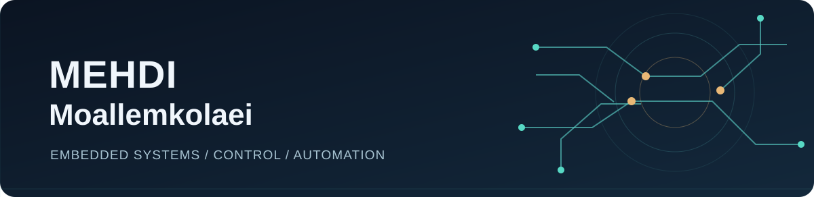
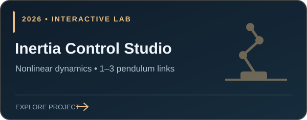
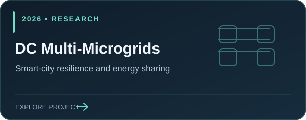

 

**Embedded Systems Engineer · Control & Simulation · Hands-on R&D**

Tampere, Finland · M.Sc. Embedded Systems, Tampere University · **With distinction, 2026**

 

I build and test systems that connect **hardware, control and software**. My work includes embedded electronics, mechanical design, automation and DC microgrid research.

### Selected work

<table>
<tr>
<td width="50%" valign="top">

<h3>Inertia Control Studio</h3>

Model, tune and balance a cart with one to three pendulum links.

JavaScript · Three.js · LQR / PID / fuzzy

</td>
<td width="50%" valign="top">

<h3>DC Multi-Microgrids</h3>

Four connected DC microgrids. Local control, energy sharing and resilience studies.

MATLAB · Simulink · Digital twins

</td>
</tr>
<tr>
<td width="50%" valign="top">

<h3>Smart Hospital Bed</h3>

An IoT prototype for sensing, bed positioning and connected monitoring.

Arduino · Raspberry Pi · MQTT · Node-RED

</td>
<td width="50%" valign="top">

<h3>GPU Satellite Simulation</h3>

A team project that compares serial, CPU-parallel and GPU execution.

C · OpenMP · OpenCL · SDL2

</td>
</tr>
<tr>
<td width="50%" valign="top">

<h3>Nasir Driving Simulator</h3>

Bachelor's thesis: compare real and simulated driving behavior.

Driver data · K-nearest neighbors · Python · MATLAB

</td>
<td width="50%" valign="top">

<h3>FPV Quadcopter CAD</h3>

A mechanical assembly with parts, drawings and exploded views.

CAD · Mechanical design · Assembly

</td>
</tr>
</table>

Project banners use concept artwork. Screenshots and technical records are identified on each project page.

<strong>More electronics, control and software projects</strong>

 

| Project | Focus |
| :-- | :-- |
| [PID Stepper Motor](https://github.com/Ace-Alch/PID_StepperMotor) | Arduino control with live gain adjustment |
| [DJI Mavic Simulation](https://github.com/Ace-Alch/dji-mavic-sim) | Quadcopter dynamics and PID flight control |
| [MEMS Force Sensor](https://github.com/Ace-Alch/mems-force-sensor) | Sensor design and multiphysics simulation |
| [Automated Sorting Conveyor](https://github.com/Ace-Alch/automated-sorting-conveyor) | Mechanics, sensing and embedded control |
| [Adjustable Conveyor Fixture](https://github.com/Ace-Alch/adjustable-conveyor-fixture) | Fixture design and sorting timing |
| [Sounder](https://github.com/Ace-Alch/Sounder) | ATmega328P signal generation |
| [LED Matrix Game](https://github.com/Ace-Alch/LED-Matrix-Game) | Bare-metal C and ARM assembly on PYNQ-Z1 |
| [Shiftfolio](https://shiftfolio.vercel.app/) | Bilingual schedule app, in development |

[Full project directory](portfolio/PROJECTS.md) · [Publication status](portfolio/PUBLICATION-STATUS.md)

### Tools I work with

<strong>Technical background</strong>

 

| Area | Experience |
| :-- | :-- |
| Embedded and electronics | ESP32, AVR, PYNQ, PlatformIO, circuit design, instrumentation and prototyping |
| Modeling and design | MATLAB/Simulink, nonlinear dynamics, SolidWorks, CATIA and Proteus |
| Automation and networks | PLC/TwinCAT, MQTT, Node-RED, Modbus, TCP/IP and Ethernet |
| Software and computing | JavaScript, HTML/CSS, Three.js, CMake, OpenMP and OpenCL |

**M.Sc. Embedded Systems**, Tampere University — with distinction, 2026.  
**B.Sc. Mechanical Engineering**, K. N. Toosi University of Technology.

Research work with the **DARES group at Tampere University** covered DC microgrid modeling, monitoring and resilience.

---

<strong>From physical systems to working software.</strong>  <a href="mailto:mehdi.moallemkolaei@yahoo.com">Email</a> · <a href="https://ace-alch.github.io/">Portfolio</a> · <a href="https://github.com/Ace-Alch?tab=repositories">Repositories</a>

