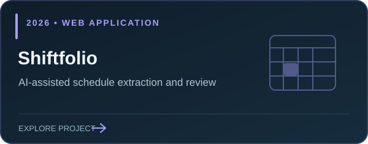
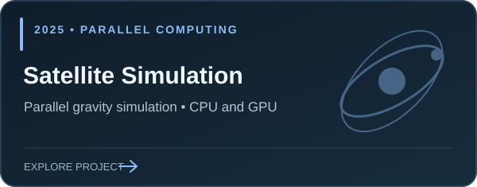

 

**Embedded Systems Engineer** · **Control & Simulation** · **Cyber-Physical Systems**

📍 Finland &nbsp;·&nbsp; 🎓 M.Sc. Embedded Systems, Tampere University — **with distinction (2026)**

---

### 👋 A little about me

I build and test systems where **hardware, control algorithms, and software** meet. My background spans mechanical engineering, embedded development, industrial automation, and applied research in resilient DC microgrids.

**My focus:** hands-on R&D · embedded control · smart energy · modeling & simulation

[Browse all 52 project records](portfolio/PROJECTS.md)

### ✦ Selected work

<table>
<tr>
<td width="50%" valign="top">

 <strong>DC Multi-Microgrids</strong> 
MATLAB · Simulink · distributed energy control 
A four-microgrid smart-city digital twin with energy-sharing and resilience scenarios. 
<a href="https://urn.fi/URN:NBN:fi:tuni-202606298025">Published thesis ↗</a>
</td>
<td width="50%" valign="top">

 <strong>Inertia Control Studio</strong> 
JavaScript · Three.js · LQR / PID / fuzzy 
An interactive nonlinear cart–pendulum laboratory with 1–3 links and controller optimization. 
<a href="https://github.com/Ace-Alch/Inertia-Control-Studio">Source & documentation ↗</a>
</td>
</tr>
<tr>
<td width="50%" valign="top">

 <strong>Shiftfolio</strong> · In development 
AI APIs · Cloudflare · Vercel 
A bilingual schedule-management web app with image extraction and editable review. 
<a href="https://shiftfolio.vercel.app/">Open web app ↗</a>
</td>
<td width="50%" valign="top">

 <strong>GPU-Accelerated Satellite Simulation</strong> 
C · OpenMP · OpenCL · SDL2 
A gravitational simulation comparing serial, CPU-parallel, and GPU execution. 
<a href="https://github.com/Ace-Alch/GPU-Accelerated-Satellite-Sim">Source & visualization ↗</a>
</td>
</tr>
</table>

<strong>More hardware, robotics & IoT projects</strong>

 

| Project | What I built or modeled |
| :-- | :-- |
| [PID Stepper Motor](https://github.com/Ace-Alch/PID_StepperMotor) | Arduino motor control with live PID tuning |
| [DJI Mavic Simulation](https://github.com/Ace-Alch/dji-mavic-sim) | Quadcopter dynamics and closed-loop control in Simulink |
| [FPV Drone CAD](https://github.com/Ace-Alch/CAD_FPV_Drone) | Mechanical design and assembly |
| **Smart Hospital Bed** | IoT monitoring prototype using Arduino, Raspberry Pi, MQTT, and Node-RED |
| [Sounder](https://github.com/Ace-Alch/Sounder) | Embedded sound generation and electronics design |
| [LED Matrix Game](https://github.com/Ace-Alch/LED-Matrix-Game) | FPGA/PYNQ-based interactive hardware |
| **CyberCity infrastructure** | Raspberry Pi sensing and networked automation experiments |

### ✦ Toolkit

**Code & embedded** &nbsp;     

**Model & control** &nbsp;     

**Software & systems** &nbsp;     

<strong>See the broader technical stack</strong>

 

- **Embedded & electronics:** ESP32, AVR, PYNQ, PlatformIO, PCB/schematic design, instrumentation, soldering, prototyping
- **Simulation & mechanical design:** MATLAB/Simulink, nonlinear dynamics, Proteus, SolidWorks, CATIA
- **Automation & connectivity:** PLC/TwinCAT, Modbus, TCP/IP, Ethernet, MQTT, Node-RED
- **Software & performance:** CMake, JavaScript, HTML/CSS, Three.js, OpenMP, OpenCL, Git/GitHub, Linux

### ✦ Background

| | |
| :-- | :-- |
| **2026** | **M.Sc. Embedded Systems**, Tampere University — graduated with distinction |
| **2026** | **DARES research group**, Tampere University — summer trainee and visiting researcher; DC microgrid modeling and resilience research |
| **2022** | **B.Sc. Mechanical Engineering**, K. N. Toosi University of Technology |

<strong>Research details & directions</strong>

 

My master's thesis, [*A DC Multi-Microgrid Architecture for Smart City Resilience and Flexibility*](https://urn.fi/URN:NBN:fi:tuni-202606298025), models four interconnected DC microgrids with solar generation, batteries, controllable loads, and coordinated energy sharing. I evaluated overload, donor-selection, and local-control failure scenarios.

I'm interested in **embedded and control engineering, power electronics, industrial R&D, and dependable cyber-physical systems**, with a preference for hands-on development and testing.

---

**Let's build something useful.**

[Email](mailto:mehdi.moallemkolaei@yahoo.com) · [GitHub repositories](https://github.com/Ace-Alch?tab=repositories) · [Master's thesis](https://urn.fi/URN:NBN:fi:tuni-202606298025)

Reliable systems, from physics and hardware to software.

